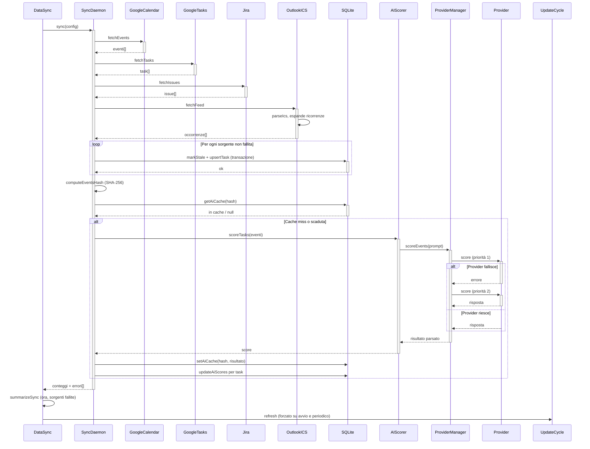
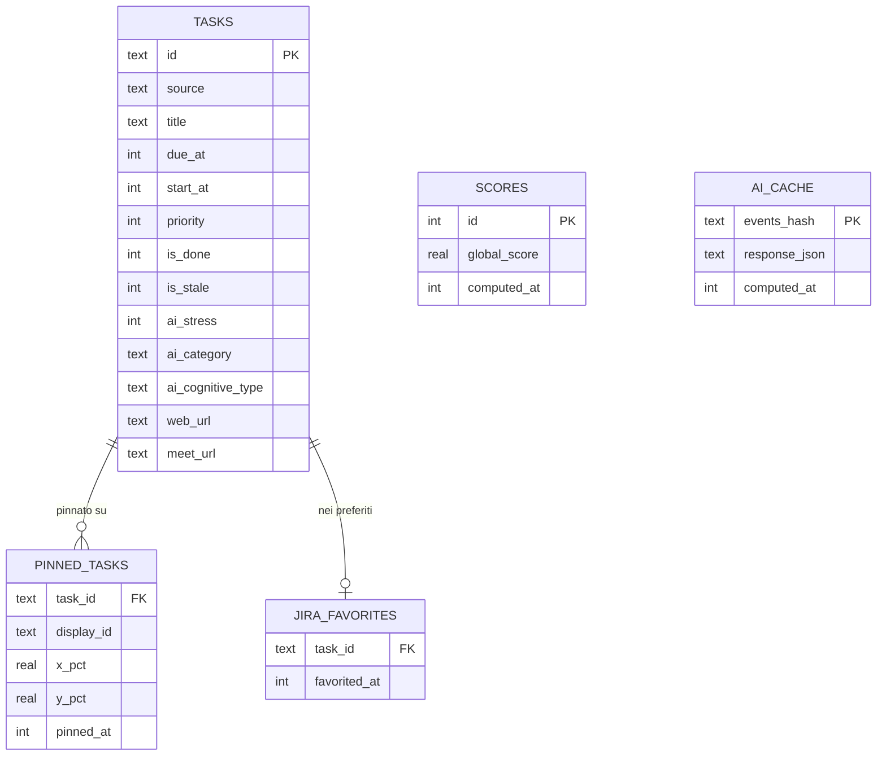
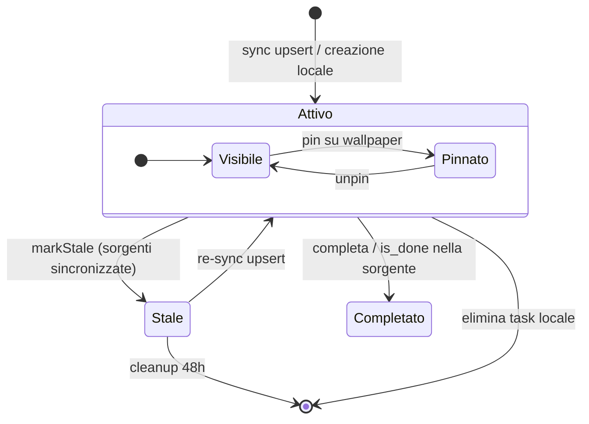
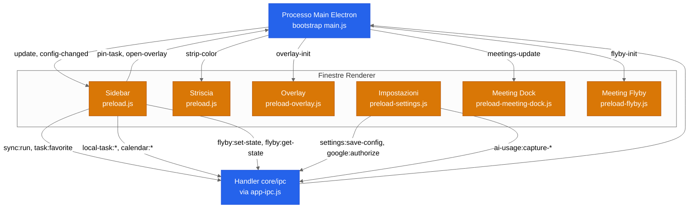
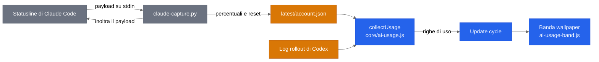

[English](./ARCHITECTURE.md) | [Italiano](./ARCHITECTURE.it.md)

# Architettura

Diagrammi tecnici degli internals di DeadlineAura. Per una panoramica ad alto livello, vedi il [README](../README.it.md#architettura).

## Pipeline Sync e AI Scoring

Tre eventi avviano una sync: l'avvio dell'app, un timer periodico (`sync.data_interval_minutes`, default 10) e l'azione "sync now" della sidebar. Un unico oggetto `DataSync` (`core/data-sync.js`) li gestisce tutti e tre e li fa passare dallo stesso ciclo (`core/sync-runner.js`): chiama il sync daemon, riduce il risultato a uno stato (`core/sync-status.js`: ora di completamento e sorgenti fallite, gli errori AI non contano), registra gli errori di sorgente, poi ridisegna tramite l'update cycle. I cicli di avvio e periodico forzano il ridisegno del wallpaper, quello manuale no. Un errore in qualsiasi punto del ciclo viene loggato e non si propaga.

Il sync daemon interroga le quattro sorgenti una dopo l'altra, persiste in SQLite quello che è tornato indietro, poi avvia l'AI scoring se il set di eventi è cambiato (cache basata su hash) o l'ultimo score è più vecchio dell'intervallo configurato (default: 6 ore). L'AI scorer prova i provider in ordine di priorità con failover automatico.

Ogni fetch è avvolto in `fetchWithErrorCapture`, quindi una sorgente irraggiungibile registra un errore e lascia intatte le altre. La persistenza è poi condizionata: solo le sorgenti che hanno risposto vengono marcate stale e riscritte, così un guasto di rete non cancella dal desktop i task di quella sorgente.

Outlook è l'unica sorgente che non è un client API. Scarica il documento ICS pubblicato e lo espande in locale (`core/ics-parser.js`), trasformando ogni occorrenza di una serie ricorrente in un task a sé, applicando le eccezioni e scartando le cancellazioni.

L'update cycle (`core/update-cycle.js`) trasforma i dati salvati in quello che mostrano le finestre. `core/update-payload.js` ricava le opzioni del motore dalla configurazione, legge le note AI (la nota e la previsione giornaliera di stress) dall'ultima riga di `ai_cache` e compone l'aggiornamento della sidebar insieme allo stato della sync, all'autorizzazione di Google Calendar e al flag del suggerimento di primo avvio. Lo stesso stato della sync permette alla finestra impostazioni di distinguere una sorgente in errore da una sana (`core/source-status.js`). Il Google OAuth sta in `integrations/google-auth.js`.

File chiave: `core/data-sync.js`, `core/sync-runner.js`, `core/sync-status.js`, `core/sync-daemon.js`, `core/update-cycle.js`, `core/update-payload.js`, `core/source-status.js`, `integrations/google-auth.js`, `integrations/outlook.js`, `core/ics-parser.js`, `ai/provider-manager.js`, `ai/prompt.js`

## Schema Database

SQLite con WAL mode. Cinque tabelle: `tasks` è l'entità centrale, `pinned_tasks` e `jira_favorites` la referenziano con CASCADE delete. `scores` conserva lo storico del global score (retention 7 giorni). `ai_cache` è indicizzata per hash SHA-256 del set di eventi attivi.

La colonna `source` porta un vincolo CHECK che elenca i valori ammessi, oggi `gcal`, `gtasks`, `jira`, `local` e `outlook`. SQLite non sa modificare un vincolo sul posto, quindi ogni nuova sorgente comporta la ricostruzione della tabella: le migrazioni in `store/migrations.js` lo fanno in modo idempotente, copiando le righe e facendo prima uno snapshot del database (`store/db-backup.js`). Un backup fallito interrompe la migrazione. La creazione delle tabelle e delle tabelle secondarie sta nei file SQL numerati di `store/migrations/` (da 001 a 007), applicati in ordine a ogni avvio; le colonne aggiunte (`web_url`, `ai_cognitive_type`, `start_at`, `meet_url`) sono `ALTER TABLE` con controllo di esistenza nello stesso modulo, mentre le estensioni `local`, `gtasks`, categoria `off` e `outlook` sono ricostruzioni della tabella.

Non tutte le sorgenti riempiono tutte le colonne. `start_at` viene valorizzata dagli eventi di calendario (`gcal`, `outlook`) e resta nulla per gli elementi di backlog; `web_url` è nulla per Outlook, perché un feed pubblicato non porta con sé una pagina per singolo evento; `meet_url` contiene il link alla videochiamata quando ne è stato trovato uno nell'evento.

File chiave: `store/db.js`, `store/migrations.js`, `store/migrations/`, `store/db-backup.js`

## Ciclo di Vita dei Task

I task entrano nel sistema tramite sync (`gcal`, `gtasks`, `jira`, `outlook`) o creazione locale. I flag `is_stale` e `is_done` determinano la visibilità. I task attivi possono essere pinnati sul wallpaper come post-it. I task stale vengono rimossi dopo 48 ore. I task locali possono essere eliminati direttamente (hard delete).

File chiave: `core/sync-daemon.js`, `store/db.js`, `store/local-queries.js`, `store/pinned-queries.js`

## Comunicazione IPC

`main.js` è il bootstrap: costruisce le finestre, gli store e l'oggetto di sync, poi li collega. Non contiene più handler. Le finestre stanno in `main-process/` (`sidebar-window.js`, `strip-windows.js`, `overlay-window.js`, `settings-window.js`, `meeting-dock-windows.js`). Gli handler delle richieste sono raggruppati per argomento in `core/ipc/` come factory che ricevono le dipendenze, e `main-process/app-ipc.js` unisce i gruppi (un canale duplicato fa fallire l'avvio) e li passa a `registerIpc` (`core/ipc/register-ipc.js`), che lega ogni canale con `ipcMain.handle` o `ipcMain.on`. Overlay e meeting dock registrano i propri canali; i due canali della finestra flyby li registra `core/meeting-flyby.js`.

Il processo main comunica con sei finestre renderer attraverso cinque preload bridge (`contextIsolation: true`; sidebar e strisce condividono `preload.js`). I canali push (main verso renderer) consegnano aggiornamenti di stato. I canali request (renderer verso main) gestiscono le azioni utente e le coppie invoke/handle.

Il menu del gatto scrive tramite `flyby:set-state`, che modifica solo il blocco `meeting_flyby` della configurazione invece di salvare l'intero oggetto, così una finestra impostazioni aperta nello stesso momento non sovrascrive la sospensione (`core/flyby-snooze.js`).

File chiave: `main.js`, `main-process/app-ipc.js`, `main-process/window-handlers.js`, `core/ipc/register-ipc.js`, `core/ipc/` (gruppi di handler), `main-process/overlay-window.js`, `main-process/meeting-dock-windows.js`, `preload.js`, `preload-settings.js`, `preload-overlay.js`, `preload-meeting-dock.js`, `preload-flyby.js`

## Banda Uso AI

Una banda in fondo al wallpaper mostra quanto dei limiti di Claude e Codex è stato usato. Legge solo percentuali e orari di reset, per la finestra da 5 ore e quella da 7 giorni, e mostra una card per ogni account Claude più una per Codex. La banda viene disegnata quando `wallpaper.show_ai_usage` è attivo (default) e c'è almeno una riga.

Claude non espone i propri limiti ad altri programmi: Claude Code li passa solo al comando della statusline. Un installer (`ai-usage:capture-install` dalla finestra impostazioni, `scripts/ai-usage/capture_install.py`) mette `claude-capture.py` davanti alla statusline in ogni `settings.json` che trova (`~/.claude` e ogni profilo Cloak), dopo aver fatto un backup del file e aver registrato la statusline precedente. A ogni prompt la capture legge il payload da stdin, tiene solo `used_percentage` e `resets_at` delle due finestre e scrive uno snapshot per account (l'id account è il nome di `CLAUDE_CONFIG_DIR`, oppure `default`) in `~/.local/share/deadlineaura/ai-usage/latest/<account>.json`. Poi inoltra il payload alla statusline precedente, così l'output dell'utente non cambia, oppure stampa una riga breve `5h x% | 7d y%` se non ce n'era una. Non fa mai fallire la statusline. All'avvio l'app copia gli script in `~/.local/share/deadlineaura/bin`, così il comando installato sopravvive agli aggiornamenti dell'app.

Codex non richiede installazione: `core/ai-usage-codex.js` legge la coda dei 20 file rollout più recenti in `$CODEX_HOME/sessions` (default `~/.codex/sessions`), dal più nuovo, finché trova entrambe le finestre. Contano solo gli eventi `rate_limits` del limite `codex`, e ogni finestra è assegnata dalla sua durata (300 e 10080 minuti).

`collectUsage` restituisce una riga per account Claude (in ordine alfabetico) e poi Codex; un lettore che fallisce viene loggato e fa sparire solo le proprie righe. Una riga è marcata stale 30 minuti dopo la cattura. Quando il wallpaper è attivo, l'update cycle raccoglie le righe a ogni esecuzione, e il wallpaper changer confronta una firma di ciò che la banda disegnerebbe (fascia del 5%, livello di soglia, fascia del conto alla rovescia) con la precedente, così ridisegna solo quando il testo visibile cambia. Le soglie sono 70 (attenzione), 90 (critico) e 100 (pieno). L'agenda sopra la banda si accorcia per lasciarle spazio.

File chiave: `core/ai-usage.js`, `core/ai-usage-claude.js`, `core/ai-usage-codex.js`, `core/ai-usage-codex-fs.js`, `core/ai-usage-format.js`, `core/ai-usage-band.js`, `core/ai-usage-band-layout.js`, `core/ai-usage-card.js`, `core/ai-usage-capture-bin.js`, `core/ipc/ai-usage-handlers.js`, `scripts/ai-usage/claude-capture.py`, `scripts/ai-usage/capture_install.py`, `scripts/ai-usage/ai_usage_common.py`
