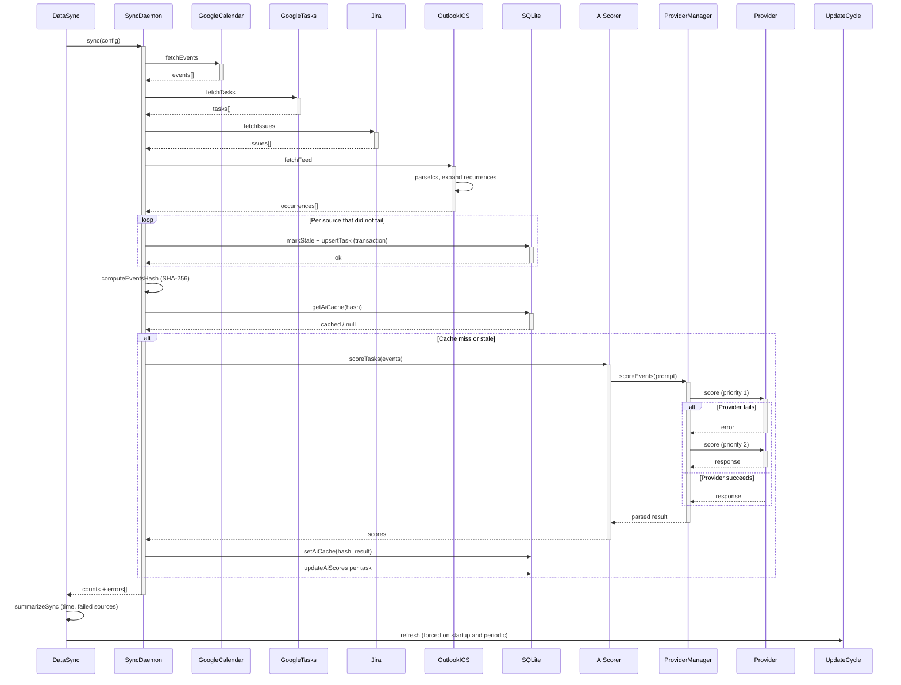
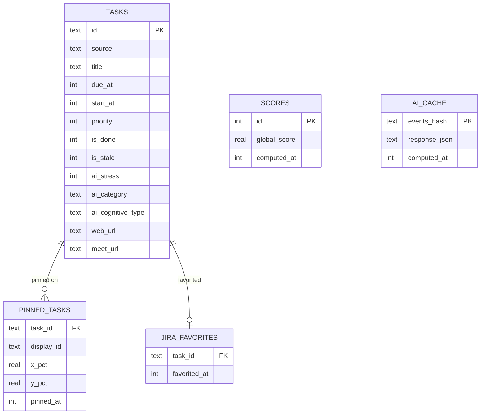
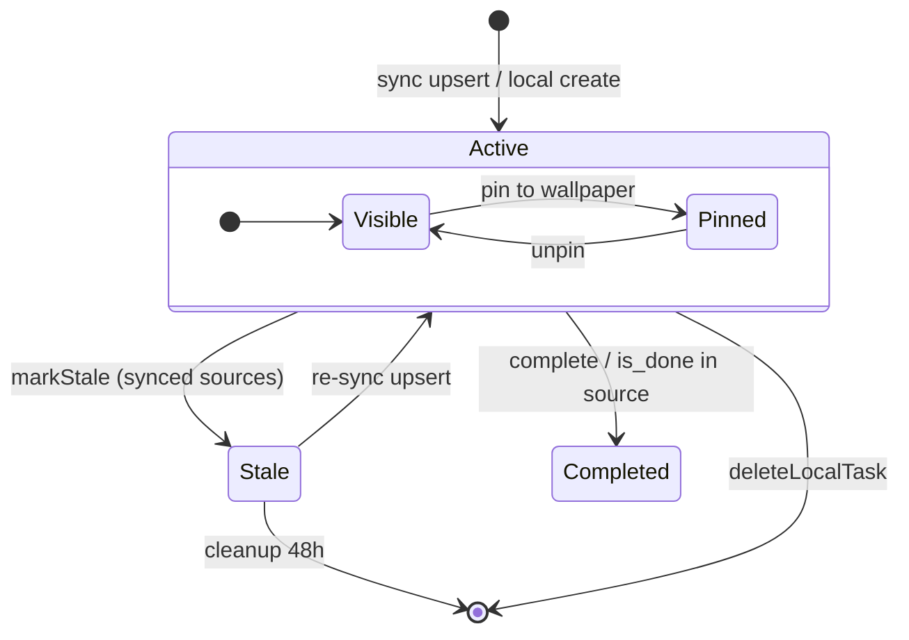
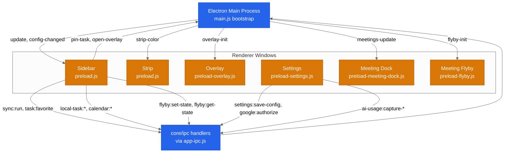
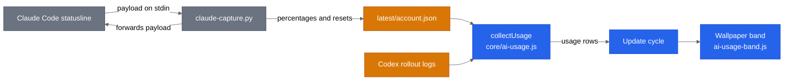

[English](./ARCHITECTURE.md) | [Italiano](./ARCHITECTURE.it.md)

# Architecture

Technical diagrams for DeadlineAura internals. For a high-level overview, see the [README](../README.md#architecture).

## Sync and AI Scoring Pipeline

Three triggers start a sync: app startup, a periodic timer (`sync.data_interval_minutes`, default 10) and the sidebar "sync now" action. A single `DataSync` object (`core/data-sync.js`) owns all three and runs each through the same cycle (`core/sync-runner.js`): call the sync daemon, reduce the result to a status (`core/sync-status.js`: completion time and failed sources, AI errors not counted), log the source errors, then redraw through the update cycle. Startup and periodic cycles force the wallpaper redraw; a manual one does not. A failure anywhere in the cycle is logged and never propagated.

The sync daemon queries the four sources one after another, persists what came back into SQLite, then triggers AI scoring if the event set has changed (hash-based cache) or the last score is older than the configured interval (default: 6 hours). The AI scorer tries providers in priority order with automatic failover.

Each fetch is wrapped in `fetchWithErrorCapture`, so a source that is down records an error and leaves the others untouched. Persistence is then conditional: only the sources that answered are marked stale and rewritten, which prevents a network failure from wiping a source's tasks off the desktop.

Outlook is the only source that is not an API client. It downloads the published ICS document and expands it locally (`core/ics-parser.js`), turning each occurrence of a recurring series into its own task, applying the exceptions and dropping the cancellations.

The update cycle (`core/update-cycle.js`) turns the stored data into what the windows show. `core/update-payload.js` derives the engine options from the config, reads the AI notes (the note and the daily stress forecast) from the latest `ai_cache` row, and assembles the sidebar update together with the sync status, whether Google Calendar is authorized and the first-run hint flag. The same sync status lets the settings window tell a failing source from a healthy one (`core/source-status.js`). Google OAuth lives in `integrations/google-auth.js`.

Key files: `core/data-sync.js`, `core/sync-runner.js`, `core/sync-status.js`, `core/sync-daemon.js`, `core/update-cycle.js`, `core/update-payload.js`, `core/source-status.js`, `integrations/google-auth.js`, `integrations/outlook.js`, `core/ics-parser.js`, `ai/provider-manager.js`, `ai/prompt.js`

## Database Schema

SQLite with WAL mode. Five tables: `tasks` is the central entity, `pinned_tasks` and `jira_favorites` reference it with CASCADE delete. `scores` stores global score history (7-day retention). `ai_cache` is keyed by SHA-256 hash of the active event set.

The `source` column carries a CHECK constraint listing the accepted values, currently `gcal`, `gtasks`, `jira`, `local` and `outlook`. SQLite cannot alter a constraint in place, so every new source means rebuilding the table: the migrations in `store/migrations.js` do it idempotently, copying the rows across and snapshotting the database first (`store/db-backup.js`). A failed backup aborts the migration. Plain table creation and the secondary tables are the numbered SQL files in `store/migrations/` (001 to 007), applied in order on every start; column additions (`web_url`, `ai_cognitive_type`, `start_at`, `meet_url`) are guarded `ALTER TABLE` statements in the same module, and the `local`, `gtasks`, `off` category and `outlook` extensions are table rebuilds.

Not every source fills every column. `start_at` is set by calendar events (`gcal`, `outlook`) and left null by backlog items; `web_url` is null for Outlook, because a published feed carries no per-event page; `meet_url` holds the video call link when one was found in the event.

Key files: `store/db.js`, `store/migrations.js`, `store/migrations/`, `store/db-backup.js`

## Task Lifecycle

Tasks enter the system through sync (`gcal`, `gtasks`, `jira`, `outlook`) or local creation. The `is_stale` and `is_done` flags determine visibility. Active tasks can be pinned to the wallpaper as post-it notes. Stale tasks are cleaned up after 48 hours. Local tasks can be deleted directly (hard delete).

Key files: `core/sync-daemon.js`, `store/db.js`, `store/local-queries.js`, `store/pinned-queries.js`

## IPC Communication

`main.js` is the bootstrap: it builds the windows, the stores and the sync object, then wires them together. It no longer holds handlers. Windows live in `main-process/` (`sidebar-window.js`, `strip-windows.js`, `overlay-window.js`, `settings-window.js`, `meeting-dock-windows.js`). Request handlers are grouped by topic in `core/ipc/` as factories that receive their dependencies, and `main-process/app-ipc.js` merges the groups (a duplicate channel throws at startup) and hands them to `registerIpc` (`core/ipc/register-ipc.js`), which binds each channel with `ipcMain.handle` or `ipcMain.on`. The overlay and the meeting dock register their own channels; the flyby window's two channels are registered by `core/meeting-flyby.js`.

The main process talks to six renderer windows through five preload bridges (`contextIsolation: true`; the sidebar and the strips share `preload.js`). Push channels (main to renderer) deliver state updates. Request channels (renderer to main) handle user actions and invoke/handle pairs.

The cat menu writes through `flyby:set-state`, which patches only the `meeting_flyby` block of the config rather than saving the whole object, so a settings window open at the same time does not overwrite the snooze (`core/flyby-snooze.js`).

Key files: `main.js`, `main-process/app-ipc.js`, `main-process/window-handlers.js`, `core/ipc/register-ipc.js`, `core/ipc/` (handler groups), `main-process/overlay-window.js`, `main-process/meeting-dock-windows.js`, `preload.js`, `preload-settings.js`, `preload-overlay.js`, `preload-meeting-dock.js`, `preload-flyby.js`

## AI Usage Band

A band along the bottom of the wallpaper shows how much of the Claude and Codex rate limits is used. It reads only percentages and reset times, for the 5-hour and the 7-day window, and shows one card per Claude account plus one for Codex. The band is drawn when `wallpaper.show_ai_usage` is on (default) and there is at least one row.

Claude does not expose its limits to other programs; Claude Code only passes them to its statusline command. An installer (`ai-usage:capture-install` from the settings window, `scripts/ai-usage/capture_install.py`) puts `claude-capture.py` in front of the statusline in every `settings.json` it finds (`~/.claude` and each Cloak profile), after backing the file up and recording the previous statusline. On each prompt the capture reads the payload from stdin, keeps only `used_percentage` and `resets_at` of the two windows, and writes one snapshot per account (the account id is the name of `CLAUDE_CONFIG_DIR`, or `default`) to `~/.local/share/deadlineaura/ai-usage/latest/<account>.json`. It then forwards the payload to the previous statusline so the user's own output is unchanged, or prints a short `5h x% | 7d y%` line when there was none. It never fails the statusline. At startup the app copies the scripts to `~/.local/share/deadlineaura/bin`, so the installed command survives app updates.

Codex needs no installation: `core/ai-usage-codex.js` reads the tail of the 20 most recent rollout files under `$CODEX_HOME/sessions` (default `~/.codex/sessions`), newest first, until both windows are found. Only `rate_limits` events of the `codex` limit count, and each window is assigned by its length (300 and 10080 minutes).

`collectUsage` returns one row per Claude account (alphabetical) and then Codex; a reader that fails is logged and drops only its own rows. A row is marked stale 30 minutes after its capture. When the wallpaper is enabled, the update cycle collects the rows at every run, and the wallpaper changer compares a signature of what the band would draw (5% bucket, threshold level, countdown bucket) with the previous one, so it redraws only when the visible text changes. The thresholds are 70 (warning), 90 (critical) and 100 (full). The agenda above the band is shortened to leave room for it.

Key files: `core/ai-usage.js`, `core/ai-usage-claude.js`, `core/ai-usage-codex.js`, `core/ai-usage-codex-fs.js`, `core/ai-usage-format.js`, `core/ai-usage-band.js`, `core/ai-usage-band-layout.js`, `core/ai-usage-card.js`, `core/ai-usage-capture-bin.js`, `core/ipc/ai-usage-handlers.js`, `scripts/ai-usage/claude-capture.py`, `scripts/ai-usage/capture_install.py`, `scripts/ai-usage/ai_usage_common.py`
